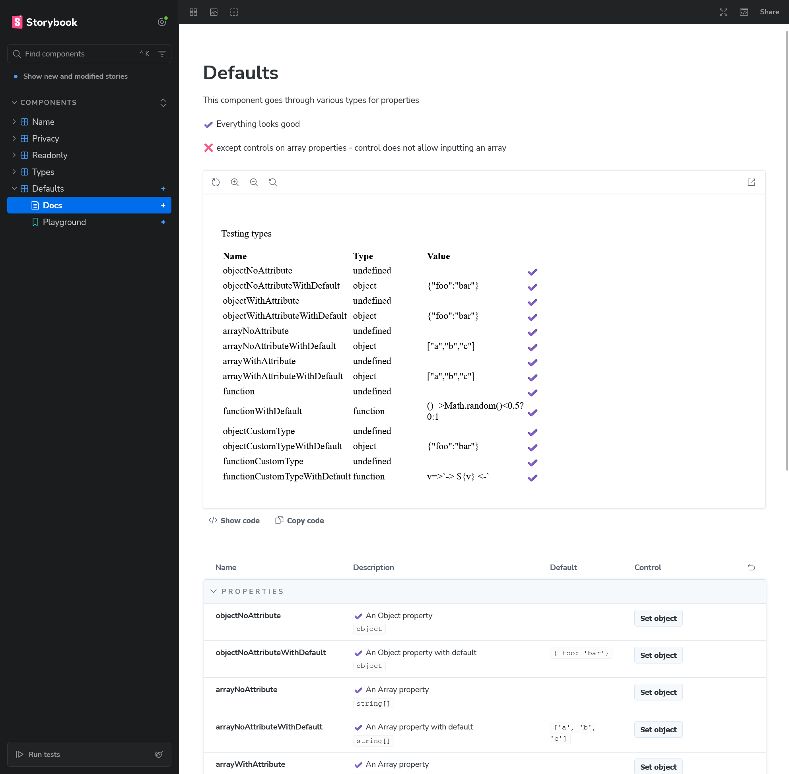

## Working as expected

- :white_check_mark: Default properties values matches the component default definition (since they are not modified unless otherwise set)

## Issues

### Array property control invalid

:x: On an array typed property, the "Set object" control does not allow to set a valid array.

#### Expected behavior

Control should allow to enter Array like values

---

### Custom typed property do not have controls

I'm not sure if this is an issue, since it's not easy to detect what's behind a custom type (object, function, etc). 

Keeping control disabled is probably the safest option.