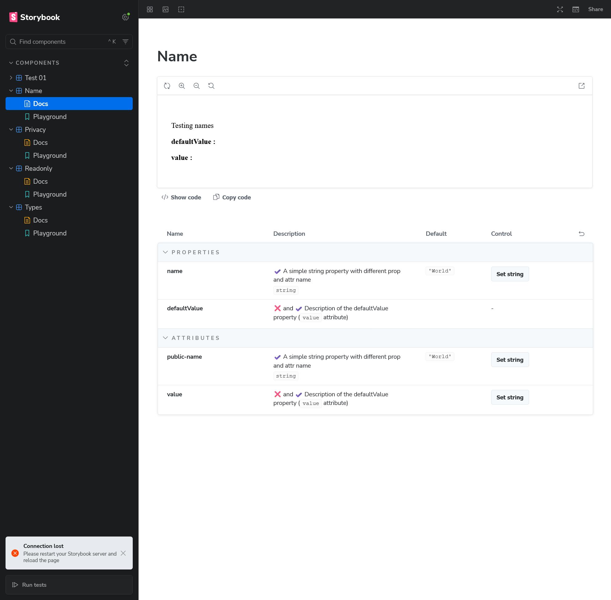

## Objective

Testing properties and attributes names handling _(both simple, and edge cases)_.

## Working as expected

- :white_check_mark: Prop with different attribute shows correctly, with one entry in props and one entry in attributes

## Issues

### Attributes and properties name collision

:x: Attributes and properties names collision cause property to not appear (same as storybook-helpers https://github.com/wc-toolkit/storybook-helpers/issues/114)
In this example, we definitely have:
- one entry in the Properties category for defaultValue,
- one entry in the Attributes category for value.

But the description of the `value` property is the description of the attribute - it should be the description of the `value` property

```js 
  /**
   * Description of the defaultValue property
   */ 
  @property({type: String, attribute: 'value'})
  accessor defaultValue;

  /**
   * The property description shadows the attribute being tied to `defaultValue`
   */
  @property({type: String, attribute: false})
  accessor value;
```

### Attributes and properties name collision controls issue

:x: Setting the control value of the `value` attribute actually sets the `value` property, when it should change the `defaultValue` property

