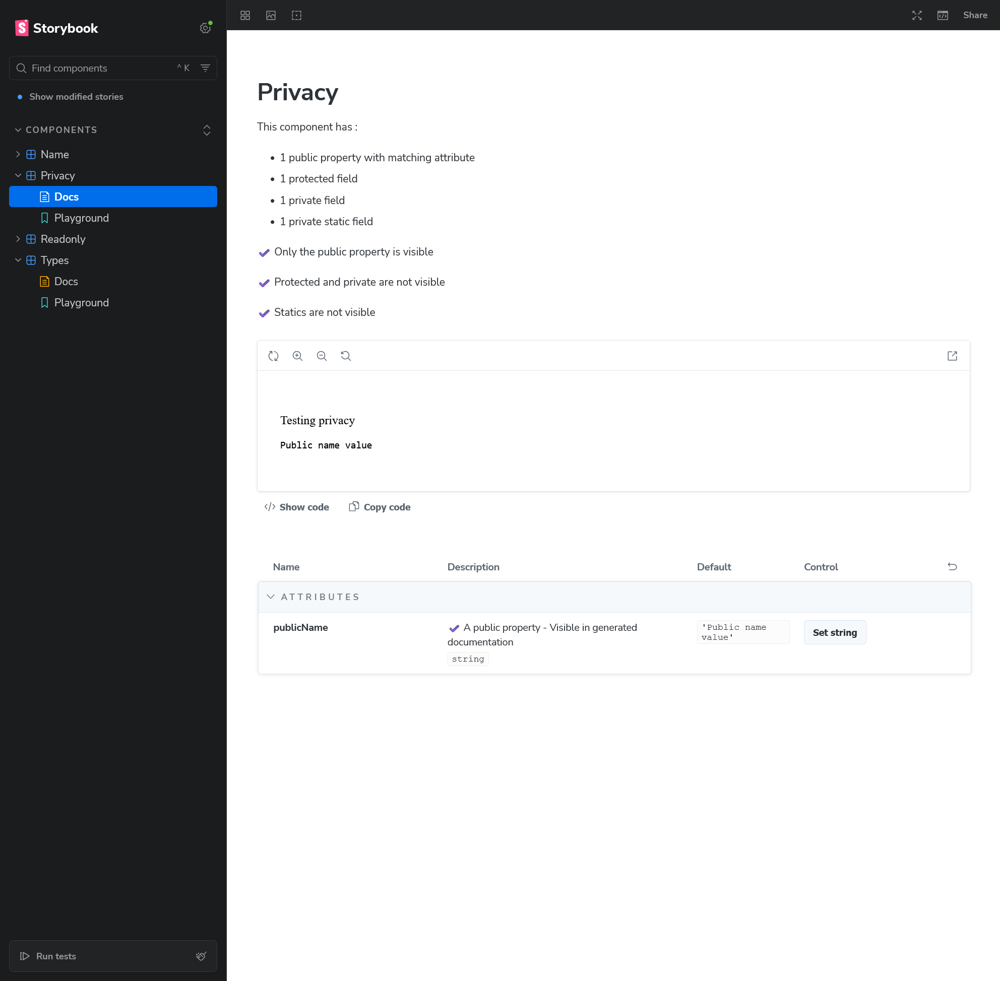

## Objective

Testing respect of 'privacy' field in the CEM.

## Working as expected

- :white_check_mark: Public prop/attr shows up in the generated description


## Issues

### Protected fields

Private field are visible in the generated documentation, even when correctly flagged in manifest.
```json
{
  "kind": "field",
  "name": "_protectedName",
  "type": {
    "text": "string"
  },
  "default": "'World'",
  "description": "A protected property",
  "privacy": "protected"
}
```

#### Expected behavior

Protected fields should not be visible

---

### Private fields

:x: Private field are visible in the generated documentation, even when correctly flagged in manifest.
```json
{
  "kind": "field",
  "name": "__privateName",
  "type": {
    "text": "string"
  },
  "default": "'World'",
  "description": "A private property",
  "privacy": "private"
}
```

#### Expected behavior

Private fields should not be visible