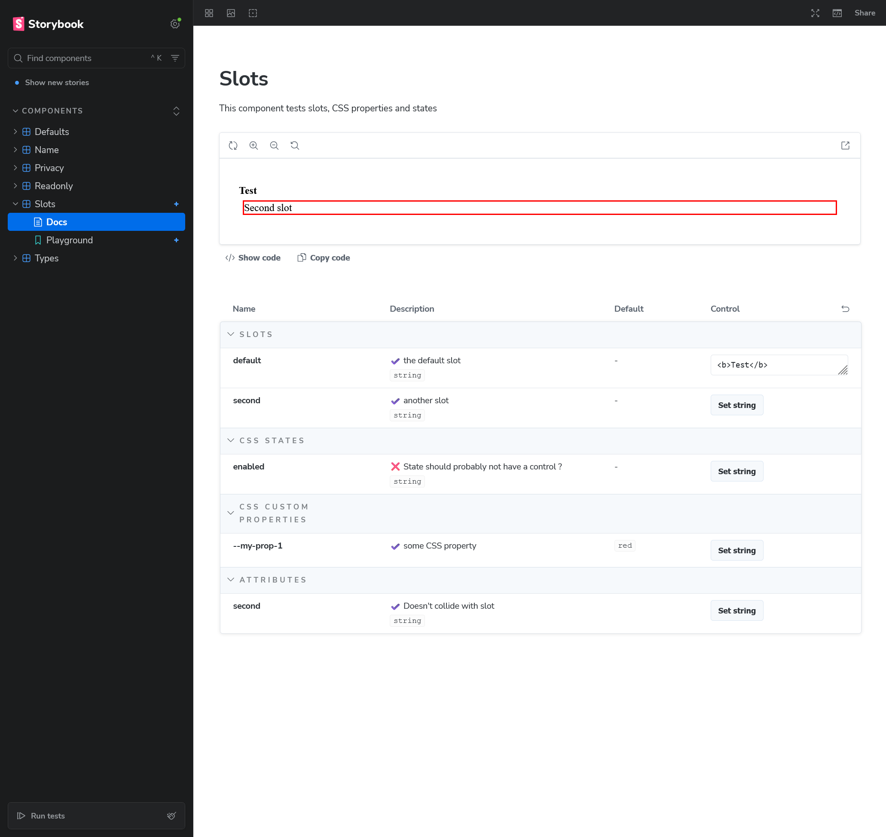

## Objective

Testing slots, CSS properties and states

## Working as expected

- :white_check_mark: Slots show in generated documentation
- :white_check_mark: Slots renders HTML when entered String is an HTML element
- :white_check_mark: Slots names doesn't collide with other props/attributes
- :white_check_mark: CSS properties show in generated documentation
- :white_check_mark: CSS properties update when changed via control
- :white_check_mark: CSS states show in generated documentation

## Issues

CSS states should probably not have a control ?