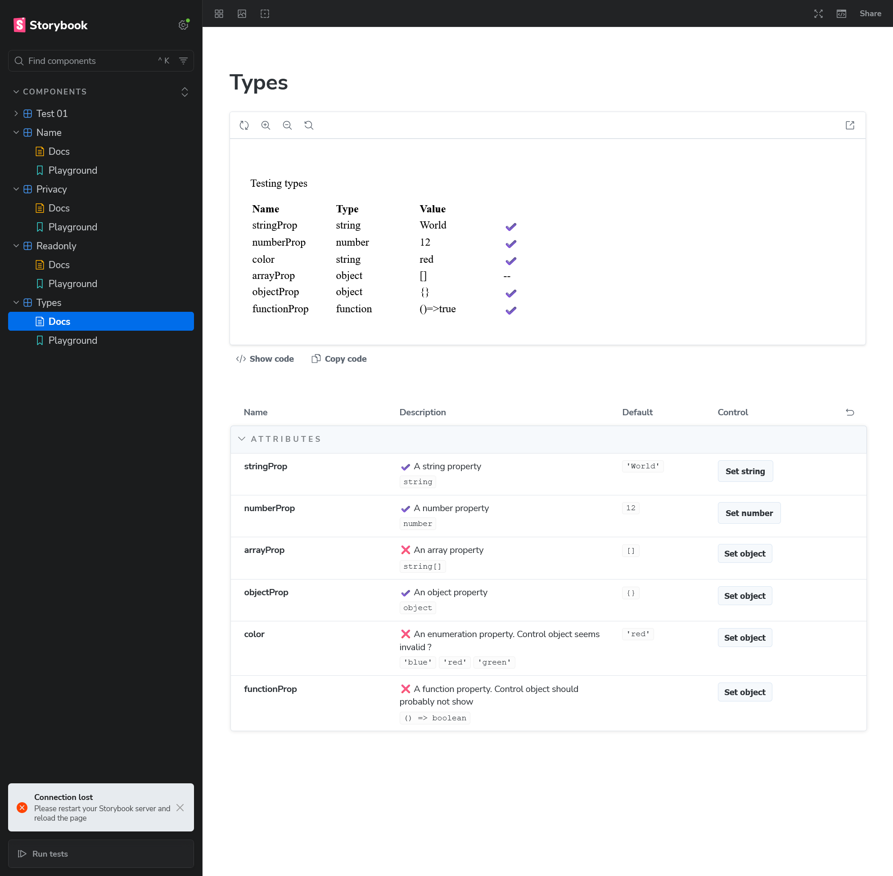

## Working as expected

- :white_check_mark: String property works fine
- :white_check_mark: Number property works fine
- :white_check_mark: Object property works fine
- :white_check_mark: Non-primitive property works fine - aka show no control

## Issues

### Array property control invalid

:x: On an array typed property, the "Set object" control does not allow to set a valid array. 

#### Expected behavior

Control should allow to enter Array like values
